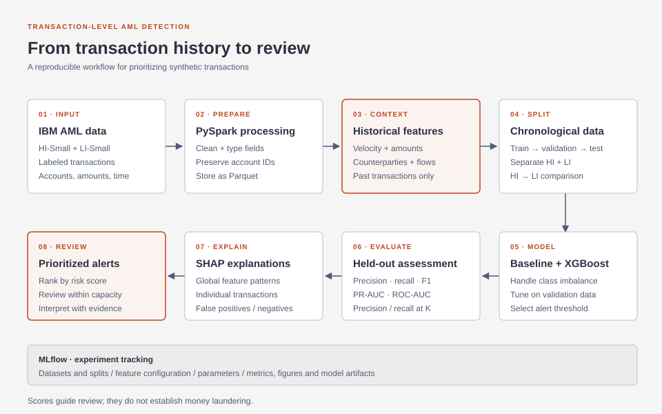

# AML Detection Pipeline

An end-to-end anti-money laundering detection project using synthetic financial transactions. It brings together PySpark feature engineering, XGBoost classification, MLflow experiment tracking, and SHAP explanations to study how transaction behavior can support alert prioritization.

## Approach

The project uses the IBM AML HI-Small and LI-Small datasets, where each record represents a transaction between accounts. PySpark prepares the data and builds transaction-level features from account and counterparty history: transaction frequency, amounts, incoming and outgoing activity, and reciprocal transfers. Historical features use only transactions available before the prediction time.

Chronological training, validation, and test splits preserve the ordering of transactions. A simple baseline provides a reference for XGBoost, while validation data supports model selection and alert-threshold selection. Evaluation focuses on precision, recall, F1, average precision, ROC-AUC, and precision and recall at a given review capacity.

MLflow organizes experiment configurations, metrics, and model artifacts. SHAP provides global feature importance and individual transaction explanations. Separate HI and LI experiments, together with an HI-to-LI evaluation, support comparison across the two synthetic datasets.

## Interpretation

The model scores transactions for review; a score or behavioral pattern is not proof of money laundering. The datasets are synthetic, and their results should be interpreted within that setting. The project is designed for reproducible local experiments, using Spark in local mode and native XGBoost after feature processing.

## Tools

Python · PySpark · XGBoost · MLflow · SHAP · scikit-learn
